# Children’s games UI review

The final design keeps bold purple outlines, raised cards and gold accents. Puzzle interiors use lighter borders and larger text to make letters easier to scan.

Before images were captured before each screen’s update; some include earlier improvements from this PR. Questions and puzzle layouts are randomized. Laptop comparisons use 1366 × 900; phone comparisons use 390 × 844. Profiles shown are local test profiles.

## Library

| Device | Before | After |
| --- | --- | --- |
| Laptop | 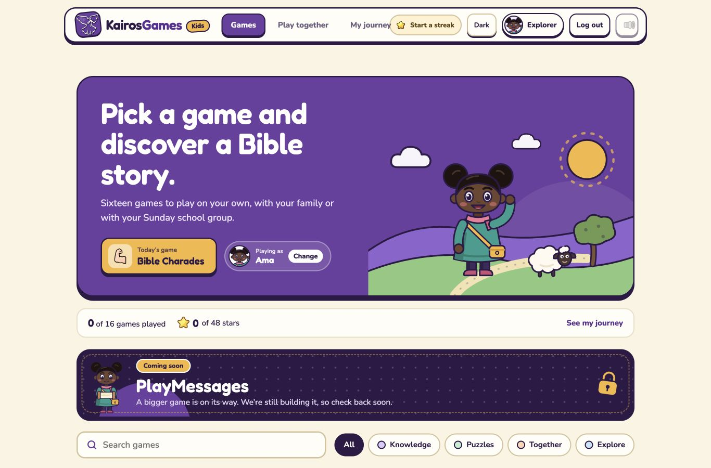 | 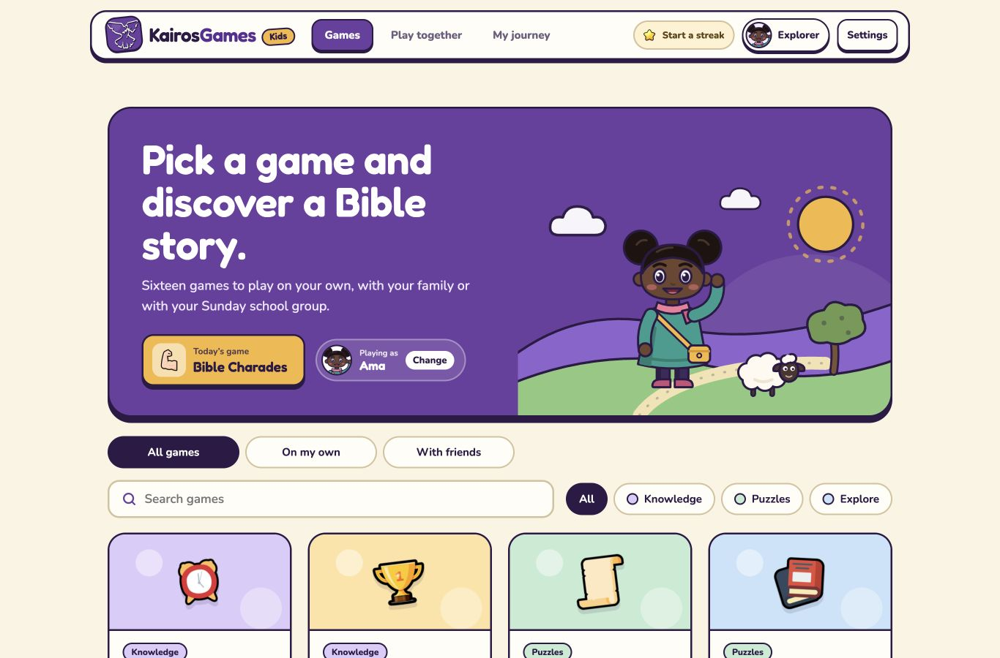 |
| Phone | 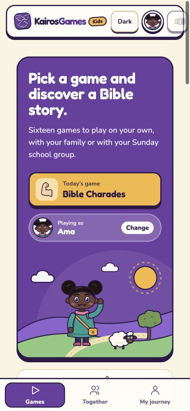 | 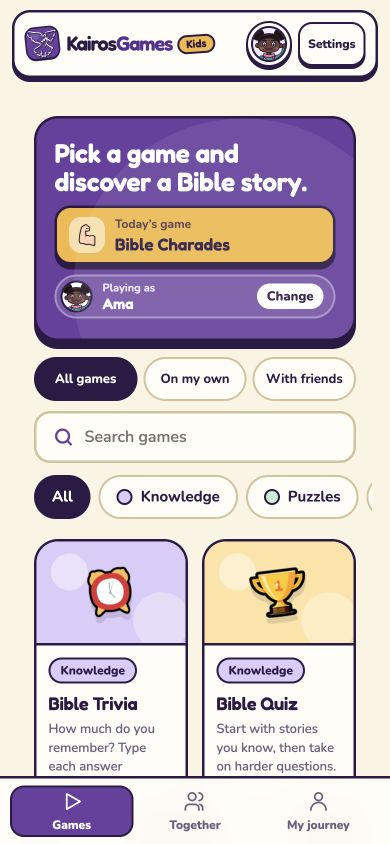 |

## Quiz

| Device | Before | After |
| --- | --- | --- |
| Laptop | 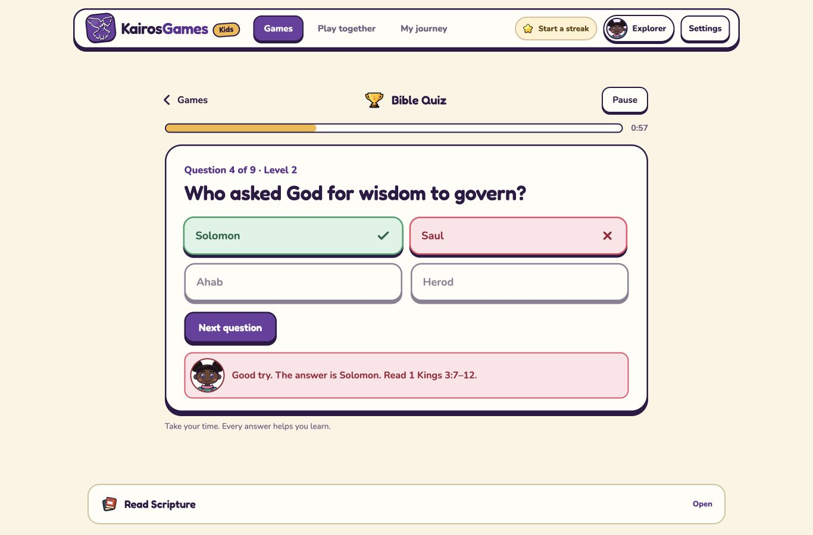 | 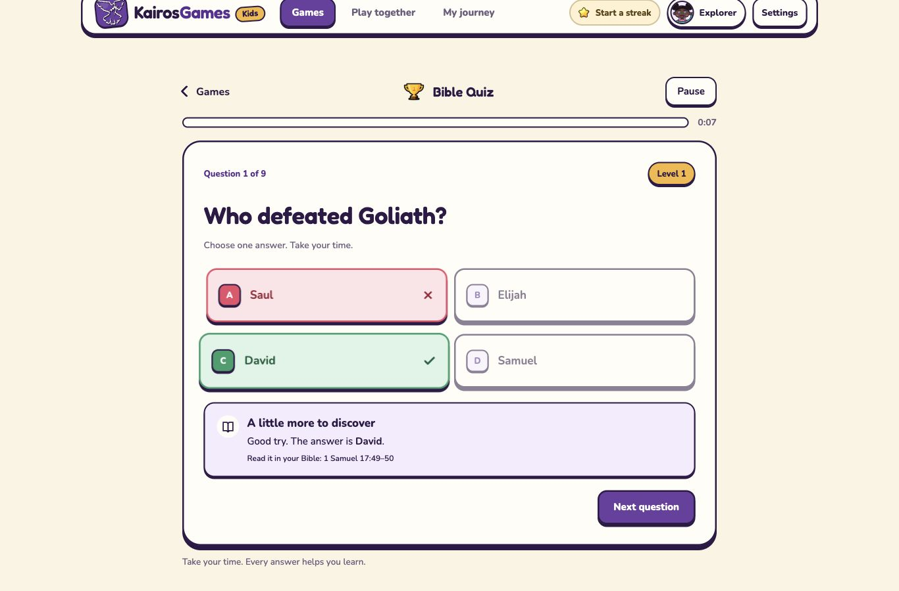 |
| Phone | 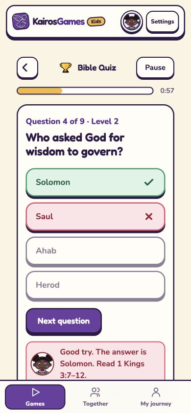 | 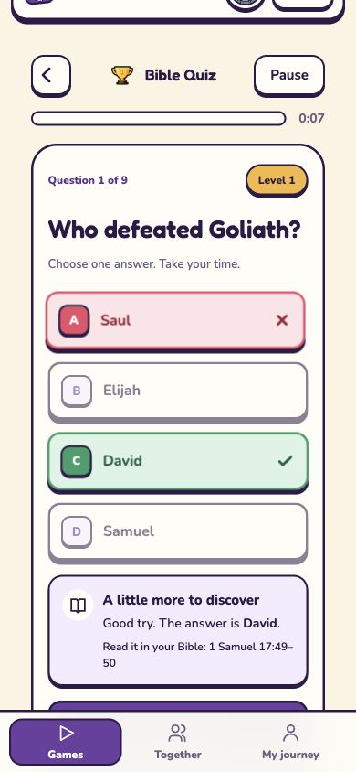 |

## Pictionary

| Device | Before | After |
| --- | --- | --- |
| Laptop | 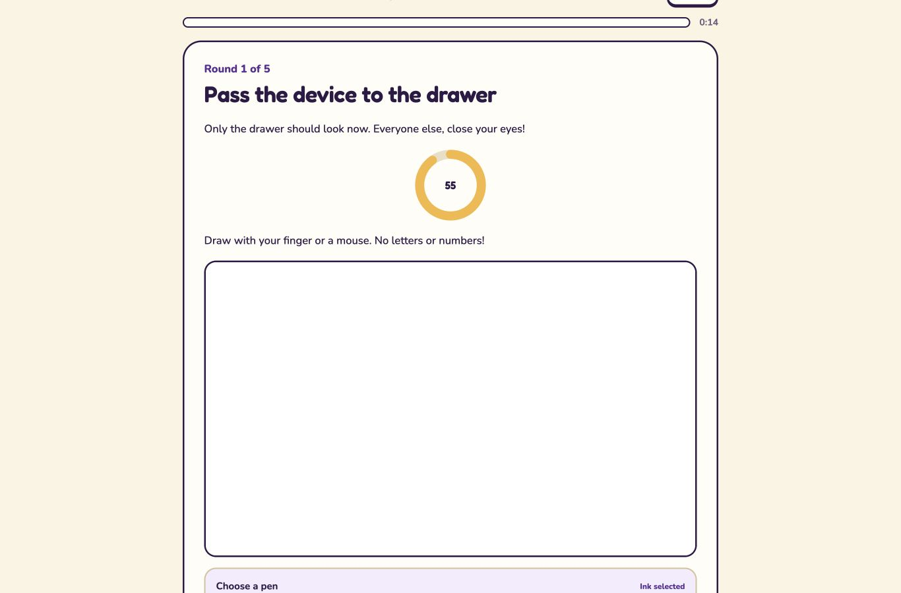 | 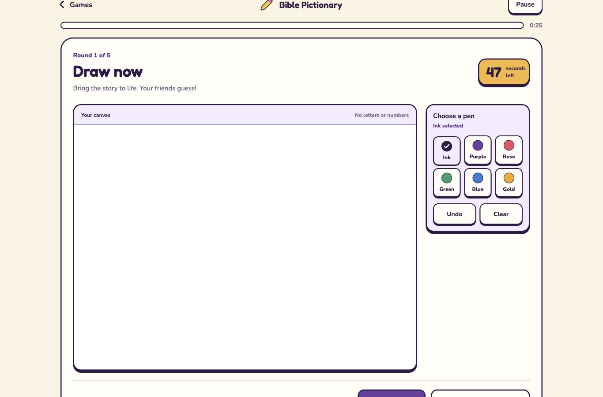 |
| Phone | 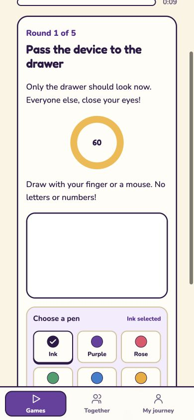 | 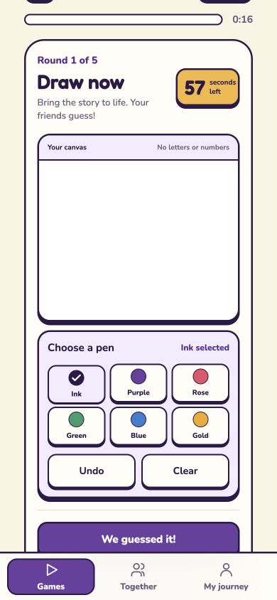 |

## Memory

| Device | Before | After |
| --- | --- | --- |
| Laptop | 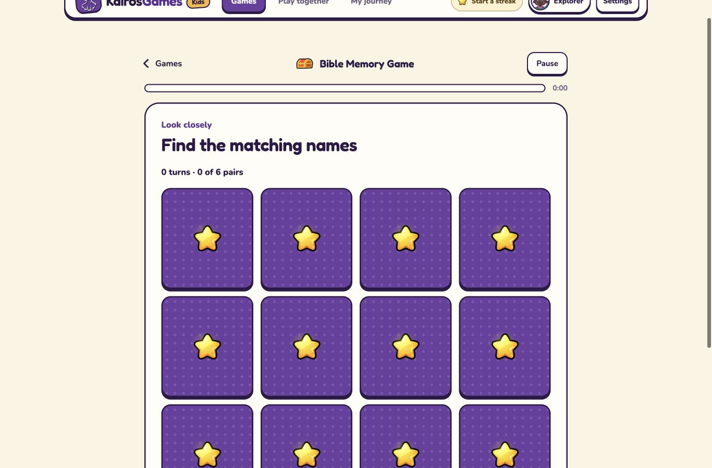 | 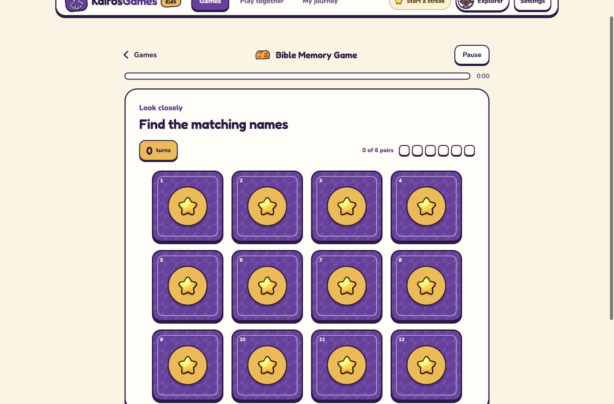 |
| Phone | 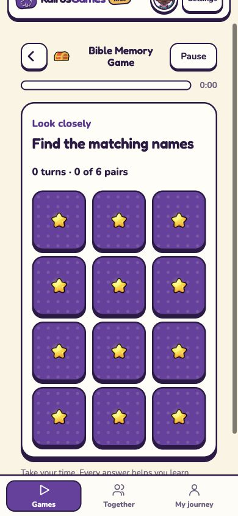 | 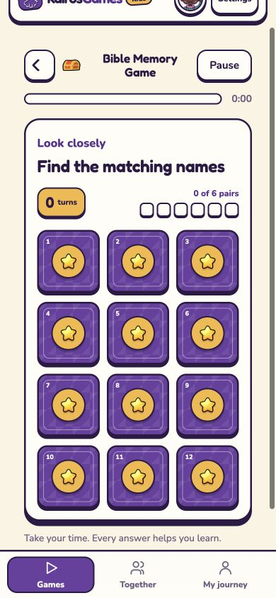 |

## Word Search

| Device | Before | After |
| --- | --- | --- |
| Laptop | 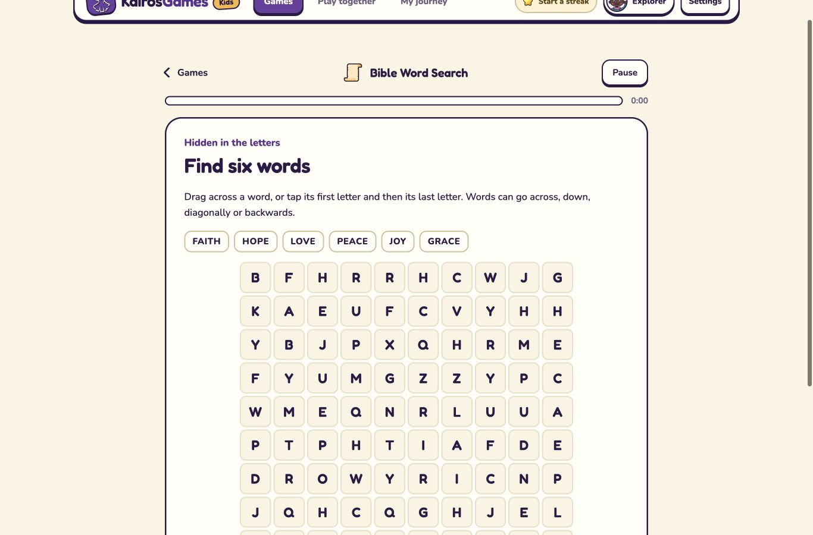 | 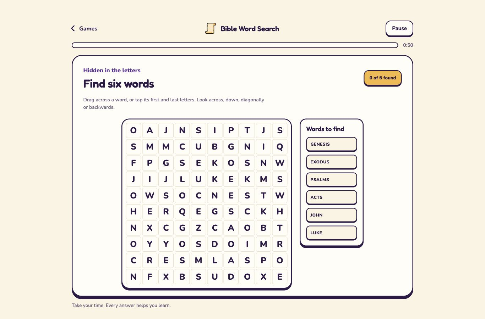 |
| Phone | 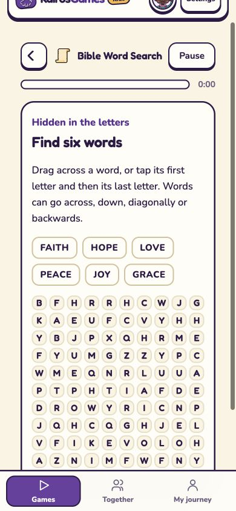 | 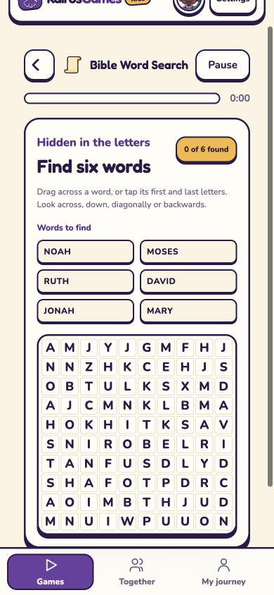 |

## Interaction and accessibility checks

- Header settings: theme and sound persistence, Escape dismissal, and narrow layouts.
- Library: combined play-style, category and search filters; reset from empty results.
- All 16 games open on phone without sideways scrolling or runtime errors.
- Quiz: correct and wrong feedback, pause/resume, all nine questions, and saved results.
- Pictionary: prompt privacy, named colours, selection state, drawing, Undo, Clear, and round transitions.
- Memory: mismatches turn back over, matches lock with accessible labels, the pair track updates, and all six pairs complete.
- Word Search: drag, tap and keyboard selection, found-word ticks, all six words complete, and labels/letter sizes fit at 320, 360, 390, 768 and 1366 px.

## Further work

Review Crossword’s grid, clues and feedback for readability and UI bugs before changing its visual treatment.
